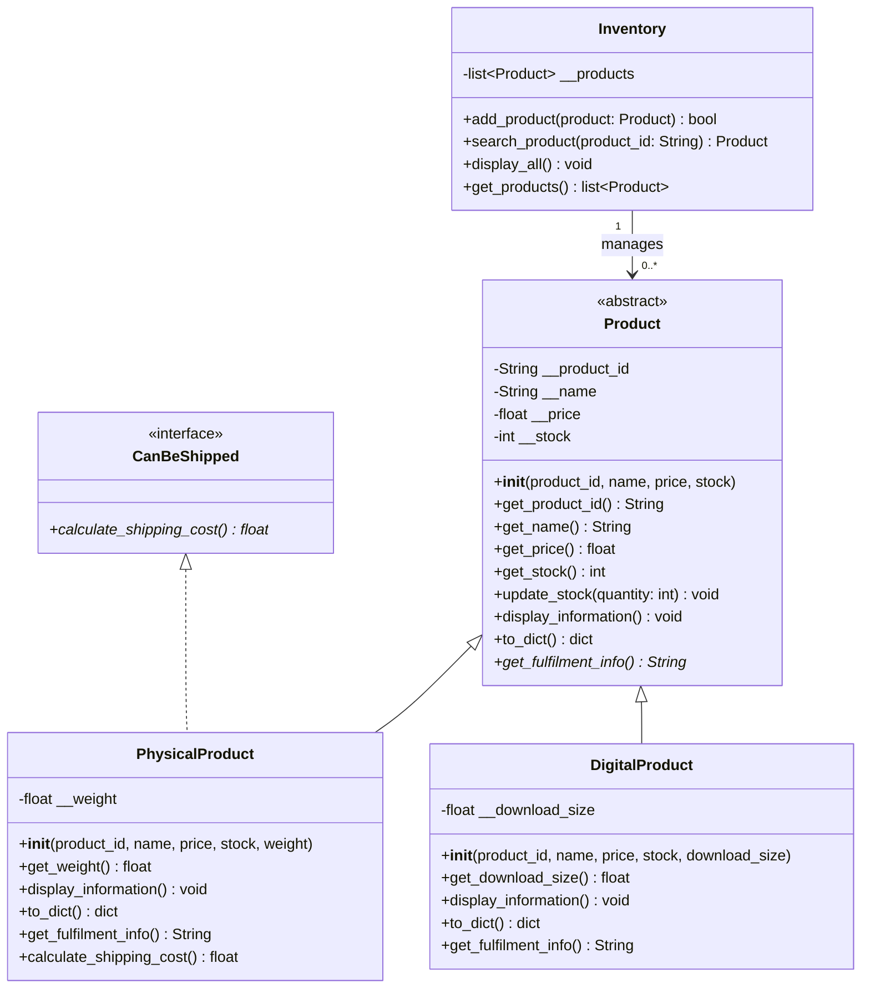

# Lab 7 UML Class Diagram

`-` = private (`__name` in Python) · `+` = public · *italics* / `{abstract}` = abstract method

## Notation used
| Line | Meaning |
|---|---|
| solid line, hollow triangle at the parent (`——▷`) | Inheritance / generalisation (is-a) |
| dashed line, hollow triangle at the interface (`- - -▷`) | Interface realisation (mustbeableto) |
| plain solid line with multiplicities | Association (Inventory manages Products) |

```
 +----------------------------+  1        0..*  +--------------------------------------------+
 |         Inventory          |---------------->|               <<abstract>>                 |
 +----------------------------+     manages     |                 Product                    |
 | - __products : list[Product]|                 +--------------------------------------------+
 +----------------------------+                 | - __product_id : String                    |
 | + __init__()               |                 | - __name       : String                    |
 | + add_product(product      |                 | - __price      : float                     |
 |     : Product) : bool      |                 | - __stock      : int                       |
 | + search_product(product_id|                 +--------------------------------------------+
 |     : String) : Product    |                 | + __init__(product_id, name, price, stock) |
 | + display_all() : void     |                 | + get_product_id() : String                |
 | + get_products()           |                 | + get_name() : String                      |
 |     : list[Product]        |                 | + get_price() : float                      |
 +----------------------------+                 | + get_stock() : int                        |
                                                | + update_stock(quantity : int) : void      |
                                                | + display_information() : void             |
                                                | + to_dict() : dict                         |
                                                | + get_fulfilment_info() : String {abstract}|
                                                +--------------------------------------------+
                                                                ▲               ▲
                                              (solid, hollow ▲) |               | (solid, hollow ▲)
                                                                |               |
 +--------------------------------------+   +-------------------------------+  +-----------------------------------------+
 |           <<interface>>              |   |        PhysicalProduct        |  |             DigitalProduct              |
 |            CanBeShipped              |   +-------------------------------+  +-----------------------------------------+
 +--------------------------------------+   | - __weight : float            |  | - __download_size : float               |
 | + calculate_shipping_cost() : float  |◁- +-------------------------------+  +-----------------------------------------+
 |                         {abstract}   |  -| + __init__(product_id, name,  |  | + __init__(product_id, name, price,     |
 +--------------------------------------+   |     price, stock, weight)     |  |     stock, download_size)               |
              (dashed, hollow ◁: realisation)| + get_weight() : float        |  | + get_download_size() : float           |
                                            | + display_information() : void|  | + display_information() : void          |
                                            | + to_dict() : dict            |  | + to_dict() : dict                      |
                                            | + get_fulfilment_info():String|  | + get_fulfilment_info() : String        |
                                            | + calculate_shipping_cost()   |  +-----------------------------------------+
                                            |     : float                   |
                                            +-------------------------------+
```

## Same diagram in Mermaid
(GitHub and VS Code's Markdown preview with a Mermaid extension draw this with real UML arrows.)



## Responsibilities (Single Responsibility Principle)

| Part | Responsibility |
|---|---|
| **Product** (abstract) | Stores the information shared by every product and manages its stock; forces subclasses to define fulfilment |
| **PhysicalProduct** | Adds weight, explains shipping fulfilment, calculates shipping cost |
| **DigitalProduct** | Adds download size, explains digital delivery |
| **CanBeShipped** (interface) | Contract that any shippable class must provide `calculate_shipping_cost()` |
| **Inventory** | Stores, adds, searches and displays a collection of Products |
| **main.py** | Shows the menu, gets user input, and loads/saves `inventory.json` |

## Open-Closed Principle
`Product` was not changed to add weight or download size: the new behaviour lives in
subclasses that *extend* it. `Inventory` works with any `Product` without knowing its type.
