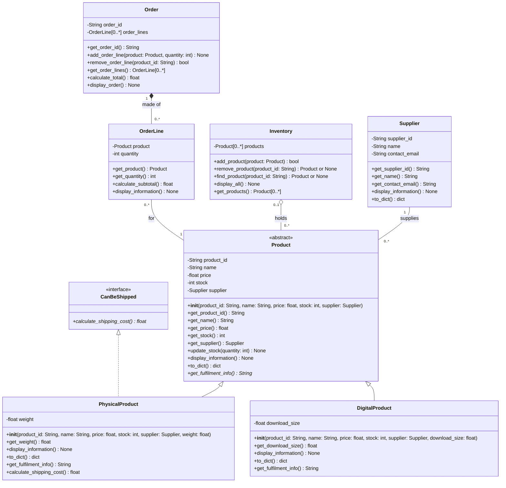

# Lab 8 UML Class Diagram

`-` = private (`__name` in Python) · `+` = public · `*` after a method = abstract · types are written after a colon

## Relationships and multiplicities

| From | Relationship | To | Multiplicity | Why |
|---|---|---|---|---|
| PhysicalProduct, DigitalProduct | Inheritance (solid line, hollow triangle at Product) | Product | – | A physical / digital product **is-a** Product |
| PhysicalProduct | Interface realisation (dashed line, hollow triangle) | CanBeShipped | – | A physical product **must be able to** be shipped |
| Supplier | Association (solid line) | Product | Supplier **1** —— **0..\*** Product | Each product has one supplier; a supplier can supply any number. Neither owns the other: both exist on their own |
| Inventory | Aggregation (hollow ◇ at Inventory) | Product | Inventory **0..1** ◇—— **0..\*** Product | A product can exist before, outside or after an inventory, and can be moved to another one |
| Order | Composition (filled ◆ at Order) | OrderLine | Order **1** ◆—— **0..\*** OrderLine | An Order creates its own lines; a line belongs to exactly one order and goes with it |
| OrderLine | Association (solid line) | Product | OrderLine **0..\*** —— **1** Product | A line refers to one product but doesn't own it; the same product can be in many lines and orders |

`supplier: Supplier` is a stored reference, but it is **association**, not aggregation: a product isn't a "whole" with
the supplier as one of its parts.

## Diagram

(GitHub and VS Code's Markdown preview with a Mermaid extension draw this with real UML arrows and diamonds.)

## Types: UML vs Python

The diagram uses language-neutral types, so it would work for Java or C# too. The Python code uses the matching
type hints:

| UML | Python type hint |
|---|---|
| `supplier: Supplier` | `self.__supplier: Supplier` |
| `products: Product[0..*]` | `self.__products: list[Product]` |
| `order_lines: OrderLine[0..*]` | `self.__order_lines: list[OrderLine]` |
| `find_product(product_id: String): Product \| None` | `def find_product(self, product_id: str) -> Product \| None` |
| `add_order_line(product: Product, quantity: int): None` | `def add_order_line(self, product: Product, quantity: int) -> None` |
| `calculate_subtotal(): float` | `def calculate_subtotal(self) -> float` |

## Responsibilities (Single Responsibility Principle)

| Part | Responsibility |
|---|---|
| **Supplier** | Stores and shows one supplier's details |
| **Product** (abstract) | Stores what every product shares, including its supplier, and manages its stock |
| **PhysicalProduct / DigitalProduct** | Add weight or download size, and their own fulfilment (and shipping cost) |
| **CanBeShipped** (interface) | Contract: anything shippable must provide `calculate_shipping_cost()` |
| **Inventory** | Holds, adds, removes, finds and displays Products |
| **Order** | Creates, removes and totals its own OrderLines |
| **OrderLine** | One product and quantity, and its subtotal |
| **main.py** | Menu, user input, and loading/saving `inventory.json` (products with their suppliers) |
