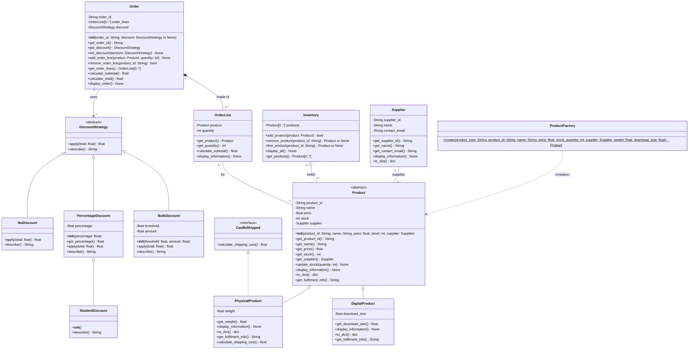

# Lab 9 UML Class Diagram

`-` = private (`__name` in Python) · `+` = public · `*` after a method = abstract · `$` after a method = static ·
types are written after a colon

New in Lab 9: **DiscountStrategy** and its four strategies (Strategy pattern), **ProductFactory** (Factory pattern),
`load_products()` and the validation rules.

## Relationships and multiplicities

| From | Relationship | To | Multiplicity | Why |
|---|---|---|---|---|
| NoDiscount, PercentageDiscount, BulkDiscount | Inheritance (solid line, hollow triangle) | DiscountStrategy | – | Each **is-a** DiscountStrategy and provides its own `apply()` |
| StudentDiscount | Inheritance | PercentageDiscount | – | A student discount **is-a** 5% percentage discount |
| Order | Association (solid line, arrow to DiscountStrategy) | DiscountStrategy | Order **0..\*** —— **1** DiscountStrategy | Each order uses exactly one strategy at a time. The strategy is made outside the order, can be swapped with `set_discount()`, and one strategy object can be shared by many orders, so it isn't part of the order |
| ProductFactory | Dependency (dashed arrow, «creates») | Product | – | The factory makes products and hands them back, but keeps no reference to them |
| PhysicalProduct, DigitalProduct | Inheritance | Product | – | A physical / digital product **is-a** Product |
| PhysicalProduct | Interface realisation (dashed line, hollow triangle) | CanBeShipped | – | A physical product **must be able to** be shipped |
| Supplier | Association | Product | Supplier **1** —— **0..\*** Product | Each product has one supplier; a supplier can supply any number |
| Inventory | Aggregation (hollow ◇ at Inventory) | Product | Inventory **0..1** ◇—— **0..\*** Product | A product can exist before, outside or after an inventory |
| Order | Composition (filled ◆ at Order) | OrderLine | Order **1** ◆—— **0..\*** OrderLine | An Order creates its own lines; a line belongs to exactly one order |
| OrderLine | Association | Product | OrderLine **0..\*** —— **1** Product | A line refers to one product but doesn't own it |

Why Order → DiscountStrategy is **association**, not composition or aggregation: a discount is something the order
*uses*, not a part of it. Composition would mean the order creates the strategy and it dies with the order, but here
the strategy is passed in, and the same `PercentageDiscount(10)` object can be given to two orders (`demo.py`
checks this).

## Diagram

(GitHub and VS Code's Markdown preview with a Mermaid extension draw this with real UML arrows and diamonds.)

## Validation rules (which class owns each rule)

| Rule | Checked in | What happens if it's broken |
|---|---|---|
| Price must be greater than zero | `Product.__init__` | `ValueError("Price must be greater than zero.")` |
| Stock cannot be negative | `Product.__init__` and `Product.update_stock()` | `ValueError`, and the old stock is kept |
| Weight / download size cannot be negative | `PhysicalProduct` / `DigitalProduct` | `ValueError` |
| Order line quantity must be greater than zero | `OrderLine.__init__` | `ValueError("Quantity must be greater than zero.")` |
| Percentage must be more than 0 and at most 100 | `PercentageDiscount` | `ValueError` |
| Unknown product type | `ProductFactory.create()` | `ValueError("Unknown product type: ...")` |

## Responsibilities (Single Responsibility Principle)

| Part | Responsibility |
|---|---|
| **DiscountStrategy** (abstract) | Contract: every discount provides `apply(total)` and `describe()` |
| **NoDiscount / PercentageDiscount / BulkDiscount / StudentDiscount** | One way of discounting a total each |
| **ProductFactory** | Decides which Product subclass to create; the only code that names them |
| **Product** (abstract) | Stores what every product shares and protects its price and stock rules |
| **PhysicalProduct / DigitalProduct** | Add weight or download size, and their own fulfilment (and shipping cost) |
| **CanBeShipped** (interface) | Contract: anything shippable must provide `calculate_shipping_cost()` |
| **Supplier** | Stores and shows one supplier's details |
| **Inventory** | Holds, adds, removes, finds and displays Products |
| **Order** | Creates and totals its own OrderLines, and passes the total to its DiscountStrategy |
| **OrderLine** | One product and quantity (greater than zero), and its subtotal |
| **product_loader.py** | `load_products()`: reads `products.csv` through the factory, skipping bad rows |
| **main.py** | Menu, user input (`get_positive_float()`), and loading/saving `inventory.json` |
